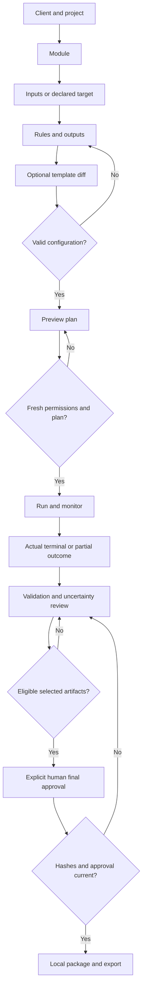

# P2 guided workflows and review model

Status: PROPOSED UX, conditional requirement references. No executable state machine or architecture chosen. [Screen catalog](P2-screens.md) defines UX-S01 through UX-S20; [requirements](../governance/01-requirements-book.md) remain individually PROPOSED. [Review cases](../test-matrix/P2-ux-coverage.md) are NOT_RUN.

## UX-F01 — Twelve-step new-job workflow
| Step | Screen / action | Required guard / retained context | Requirement references |
| --- | --- | --- | --- |
| 1 Select client/project | UX-S04 using UX-S02/03 pickers | Prefill selected project; create missing records locally; preserve draft on Back | REQ-0002, REQ-0003, REQ-0004 |
| 2 Select category | UX-S06 | Exactly one supported category; module change previews invalidated options | REQ-0006, REQ-0032 |
| 3 Import files/enter target | UX-S07 | Local format/access checks; website scope/authorization declaration without initiating a request | REQ-0005, REQ-0008, REQ-0028, REQ-0030 |
| 4 Configure rules | UX-S05 | Explicit module rules/interpretation/output paths; separate outputs default | REQ-0008, REQ-0009, REQ-0025 |
| 5 Optional template | UX-S08 | Apply-diff; independent draft; no files/secrets/old consent inherited; revalidate accepted changes | REQ-0007, REQ-0010 |
| 6 Preview plan | UX-S09 | Inputs/configuration/output paths/effects/storage/network/review checklist visible | REQ-0009, REQ-0017, NFR-0024 |
| 7 Confirm permissions | UX-S09 | Plan confirmation plus distinct website authorization and any exact destructive consent; changed plan invalidates them | REQ-0010, REQ-0028, NFR-0023 |
| 8 Execute | UX-S10 | Recheck plan/input freshness, evidence destination and output conflicts; no unconfirmed operation | REQ-0011, REQ-0017, REQ-0029 |
| 9 Monitor | UX-S10 | Actual item/phase status; cancellation stops new items and waits for truthful terminal disposition | REQ-0012, REQ-0013 |
| 10 Validate/review | UX-S12/13/14 | Validate outputs; review uncertainty; failed/unknown coverage never becomes PASS by silence | REQ-0018, REQ-0019, REQ-0031 |
| 11 Approve deliverables | UX-S15/16 | Select exact eligible artifacts; explicit human approval bound to current hashes/attempt/evidence | REQ-0020, REQ-0022, NFR-0018 |
| 12 Export package | UX-S17 | Verify approved selection/hash/manifest and local destination; no automatic transmission or deployment | REQ-0022, REQ-0023, REQ-0067 |

Safe defaults: separate output destination, no overwrite/cleanup/network request or approval, no automatic uncertain-item acceptance, explicit continue-on-error selection, no inferred parser ambiguity. Defaults are effective values shown in configuration/plan, not hidden permission grants. Save/resume drafts and context reuse reduce repeated input; permission expiry, changed files and destructive effects always need rechecking. Step 5 may be skipped; any accepted template change returns to validation before steps 6/7. Missing client can be created inline then returned to the wizard without a second draft.

## Review and approval model
Processing, validation, review and delivery are separate dimensions, shown as separate columns/badges. “Processing completed” means operations ended, not correct output. A validation PASS refers only to checks executed. No configured/evaluated checks is NOT_RUN or insufficient coverage, never PASS. A validation warning is uncertain and needs human disposition; a validation failure remains a failure even if reviewed. A confirmed website defect is a human interpretation of evidence, not a side effect of an automated assertion FAIL.

| Visible state | Meaning / permitted actions | Export eligibility |
| --- | --- | --- |
| Processing completed | Inspect item dispositions and evidence; run validation | No automatic delivery eligibility |
| Validation passed | Declared checks passed; inspect scope and preview | Still needs human final approval |
| Validation warning | Uncertainty/fidelity limit; show evidence and accept/reject rationale | Affected artifact blocked until permitted human review and then final approval |
| Validation failed | Known failed check; inspect expected/actual; fix/rerun or exclude | Failed artifact blocked; reviewing cannot relabel its validation PASS |
| Human review required | Unresolved warning/issue or final delivery pending | No silence-based consent |
| Human approved | Approval saved for exact selected hashes, attempt and findings | Eligible to package only while evidence/approval stays current |
| Ready for export | Package/manifest selection is approved and current; destination/effects checked | Local export permitted; never means delivered or deployed |

UX-F02: Review uncertainty -> inspect evidence -> accept eligible uncertainty with rationale / reject / defer -> record local reviewer/date/evidence -> preview eligible artifacts -> separate final delivery approval. A suspected website issue may be confirmed, disputed or remain uncertain; reports retain observation, reviewer disposition and limits. Uncertain findings never carry a verified-defect label before human confirmation. Confirmation of a defect is not approval to modify the target site.

UX-F03: Approval invalidation -> any changed selected artifact, selection, relevant run/config evidence or unavailable evidence marks the affected approval stale -> show exact affected items -> revalidate/review -> fresh final approval -> export rechecks hashes. An unrelated preference edit does not rewrite old approvals. Unauthorized tampering is “unverifiable”, not proof of a particular attacker. Local reviewer labels are not verified external identities (O-05 / UX-O03).

Partial/cancelled/failed runs never receive a blanket successful/approved state. A valid independent subset may be considered only if its validations/evidence are complete, exclusions and overall incomplete run are visible, and that exact subset receives fresh human approval; incomplete outputs remain ineligible. This is a conditional UX interpretation for owner review, not permission to waive data-integrity failures.

UX-F04: Offline operation -> create/configure local jobs and view help/history/reports without sign-in or internet; website target entry stays local -> before authorized live execution check connectivity -> unavailable network blocks that job with reason, leaves all local workflows available. No request is made during target editing, preview or unsupported diagnostic checks.

UX-F05: Linked retry/recovery -> inspect interrupted/failed/cancelled attempt and output status -> offer only capability-supported resume (pending O-09) or new linked retry -> revalidate current inputs/options/permissions -> separate outputs -> no inherited delivery approval. If process interruption is detected late, status says interrupted/unverified until reconciled, never invented completion.

UX-F06: Unsaved edits -> leaving a modified draft shows Save/Discard/Cancel; Cancel retains focus/context, Save failure keeps edits; Back retains draft values; no draft dialog applies to readonly history. No navigation shortcut performs consent/start.

UX-F07: Storage cleanup -> select managed items -> preview affected records/evidence/approvals -> explicit consent -> per-item delete outcome -> mark dependent evidence unavailable/stale -> retain originals/unrelated exports. No automatic cleanup to unblock a job.

UX-F08: Export failure -> preserve source/approval records -> show actual partially written destination files -> choose new name/destination or retry with fresh collision consent -> verify selected source hashes -> final local manifest summary. A provisional diagnostic/QA report may be saved locally but is visibly not an approved client package.

## Workflow acceptance
Walk all eight flows with normal, rejection, stale-evidence and interruption variants; verify every guard has a visible reason/recovery action and a non-pointer path. [Failure catalog](P2-failure-recovery.md) and defined TEST-0203 through TEST-0210 cover these flows. Runtime behavior is not verified.
