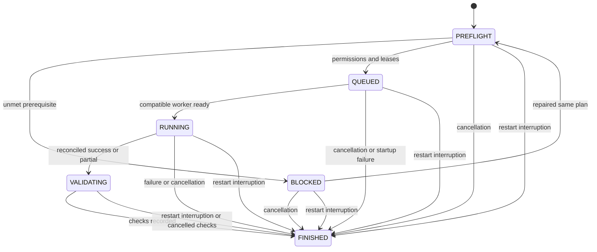
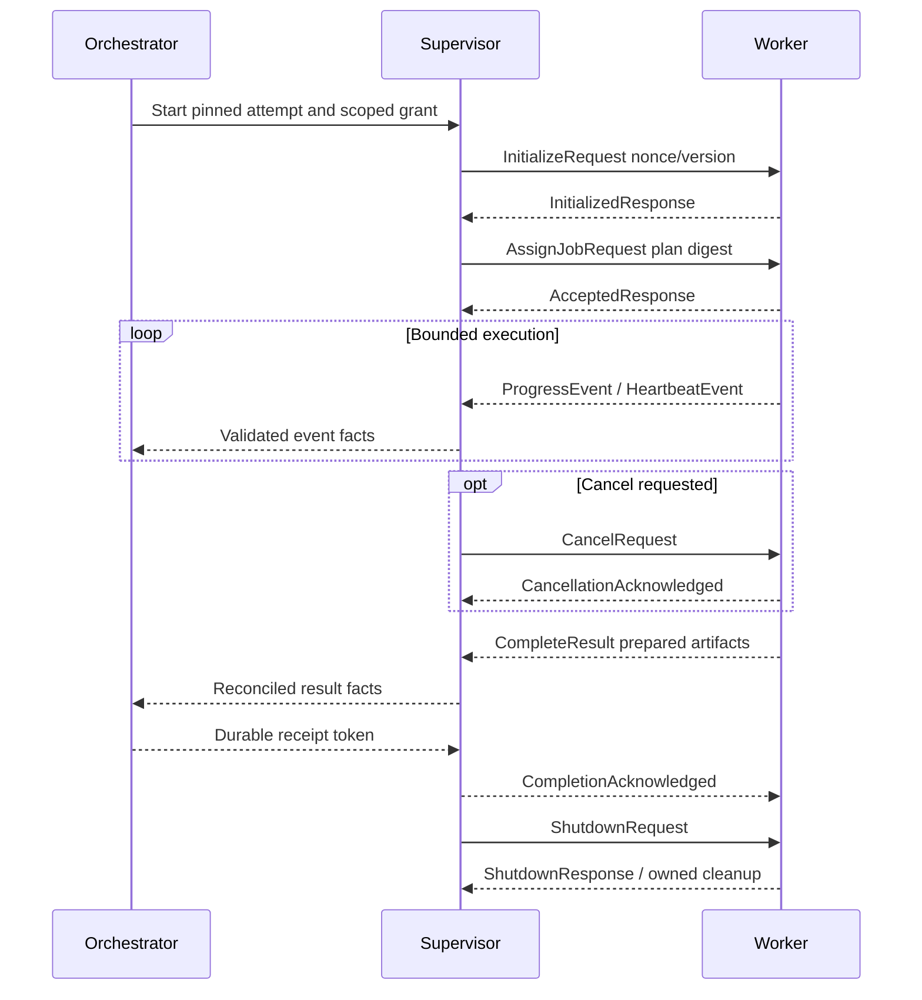

# P3 job lifecycle and worker protocol

Status: PROPOSED, no implementation/runtime proof. REQ-0004/0009/0011 through REQ-0018/0020/0024/0029/0031; NFR-0003/0011/0013/0018. [P2 review model](P2-workflows.md#review-and-approval-model) remains the UX baseline. D owns lifecycle; F owns runtime process facts; L is the sole durable writer. [ADR-0004](../adr/ADR-0004-worker-boundaries.md) proposes worker isolation and this local IPC contract.

## Separate durable dimensions
The 16 supplied labels are evaluated as a product view, not one misleading execution enum. Proposed model:
- JobVersion edit state: DRAFT or READY. READY requires saved normalized config/input references and valid supported capability. Any edit creates/updates an unexecuted draft revision; an executed version is immutable.
- Attempt phase: PREFLIGHT, BLOCKED, QUEUED, RUNNING, VALIDATING, FINISHED. Attempt references one immutable jobVersion/plan/module/config/input digest set. Outcome is PENDING until known, then SUCCEEDED, PARTIAL, FAILED, CANCELLED or INTERRUPTED. FINISHED is not approval.
- Output validation: per-check PASSED, FAILED, WARNING, INCONCLUSIVE, NOT_RUN; aggregate eligibility requires required checks and complete evidence, not simply all existing checks passed.
- Human review: UNREVIEWED, REQUIRED, CONFIRMED, DISMISSED, ACCEPTED_WARNING, REJECTED, DEFERRED as appropriate per finding/output; retained history.
- Final approval: NONE, CURRENT, STALE, REVOKED for a specific artifact-selection manifest and evidence versions. No worker authority.
- Export: NOT_PREPARED, READY_FOR_EXPORT, EXPORTING, EXPORTED, EXPORT_FAILED, STALE. A failed repackaging does not erase an earlier truthful export record.

Display label mapping: DRAFT/READY from edit state; PREFLIGHT/BLOCKED/QUEUED/RUNNING/VALIDATING from attempt phase; FAILED/CANCELLED/INTERRUPTED from immutable attempt outcome; REVIEW_REQUIRED/REVISION_REQUIRED from validation/review eligibility; APPROVED from current human manifest approval; READY_FOR_EXPORT from verified manifest/current approval and destination plan; EXPORTED from verified export record. Show separate outcome/validation/review/export columns when labels overlap. A PARTIAL outcome remains visible even if an independently eligible subset is considered for human review; subset delivery remains conditional owner interpretation, not automatic approval.

## Transition table
| Owner / from | To | Preconditions and durable effect | Rejection / recovery |
| --- | --- | --- | --- |
| B/D JobVersion DRAFT | READY | Required config/input/profile checks passed, expected revision current; immutable normalized version prepared | Invalid/unsupported data retains draft errors |
| B READY version | New DRAFT version | Explicit edit; keep original executed version and attempts | Never edit a running/executed version in place |
| D new confirmed attempt | PREFLIGHT | Fresh plan consent, pinned versions, unique attempt ID, idempotency key; persist prior to work | Stale plan/input denies start |
| D PREFLIGHT | BLOCKED | Missing permission/path/resource/evidence prerequisites; record cause | No worker/network effect |
| D BLOCKED | PREFLIGHT | Same immutable version/plan prerequisites repaired, reconfirm effects if relevant | Changed input/config requires new version/attempt |
| D PREFLIGHT | QUEUED | Capability valid, resource/output leases available, queue record committed | DB failure means not queued |
| D QUEUED | RUNNING | Unique live lease and initialized compatible worker; grant still current; persist dispatch | Duplicate/stale lease rejects; startup failure uses the separate terminal transition below |
| D QUEUED | FINISHED + FAILED | Trusted worker startup/initialization cannot proceed; record startup error and stop owned processes before releasing lease | No dispatch or inferred processing success |
| D RUNNING | VALIDATING | Worker result/evidence reconciled; SUCCEEDED or PARTIAL outcome recorded; prepared artifacts only | Bad result/protocol marks failure, not validation success |
| D VALIDATING | FINISHED | All declared checks have truthful results/evidence; outcome retained, invalid outputs ineligible | Verification failure is a finding/error; never relabel processing success as correct output |
| D QUEUED/BLOCKED/PREFLIGHT | FINISHED + CANCELLED | Explicit cancellation; queue lease removed in transaction, no work started | Invalid version/revision rejects command |
| D RUNNING | FINISHED + CANCELLED/FAILED | Cooperative cancel or escalation/timeout/error; durable dispositions after worker stop | Cancellation acknowledgement alone is not terminal outcome |
| D VALIDATING | FINISHED (processing outcome retained) | Explicit validation cancellation; completed checks retained, remaining checks NOT_RUN, cancellation audit and approval blocked | Do not overwrite a reconciled processing outcome with validation status |
| D nonterminal attempt | FINISHED + INTERRUPTED | Restart: no verified terminal facts; invalidate leases/kill verified owned orphan if needed; reconcile staging | Never infer success from an output file existing |
| J review pending/current | New review disposition | Current evidence, explicit local reviewer/time/rationale and scoped finding IDs | Missing/stale evidence or known failed output cannot be waived into PASSED |
| J eligible selection | CURRENT approval | Required validation/review complete, exact hashes/current version, durable human decision | No implicit approval from SUCCEEDED/PASSED |
| J CURRENT approval | STALE/REVOKED | Changed/removed selected artifact/evidence/selection or explicit revocation; append event | Historical record retained; fresh approval needed |
| N eligible selection | READY_FOR_EXPORT | Current approval, hashes, manifest and explicit local export plan | Unapproved/failed/missing artifact blocks |
| N READY_FOR_EXPORT | EXPORTED or EXPORT_FAILED | Prepare/write/verify local package; append export record with actual paths/hashes | Failure preserves source artifacts and earlier truthful exports |

All other transitions reject with stable INVALID_STATE and safe explanation. No terminal attempt is reset to RUNNING; retry creates a linked attempt under the same unchanged immutable version or a new version if inputs/config changed. Revalidation of a terminal attempt's preserved artifacts creates independent verification records, not a rewritten execution outcome. Cancellation during validation stops checks, marks remaining NOT_RUN and keeps approval blocked; no output auto-delivered. Completion vs cancellation race uses expectedRevision and received result order: if the processing result committed first, processing cancellation reports already ended and a separate validation-cancel command may stop remaining checks; if cancellation wins before processing result reconciliation, its outcome reflects actual item dispositions, never two terminal writes.

Every transition transaction checks expected revision, lease/attempt identity, allowed predecessor and permission expiry; atomically appends audit and changes state. On audit commit failure no durable state success is reported. Read models may be stale and expose their revision. Restart reconciliation runs before new dispatch: expire leases, compare process creation token not PID alone, reconcile artifact intents and identify missing evidence. Safe shutdown stops dispatch, requests cancellation, waits proposed grace, terminates only owned processes, records interruption where unresolved and closes DB safely.

Diagram is attempt phase only; DRAFT/READY and human approval/export dimensions are separate. Outcome is a field on FINISHED, never an implicit approval.

## Worker creation and initialization
F launches only an installed trusted worker package matching G's pinned module/version/digest with fixed argument schema; never imported scripts, shell command concatenation or a user-supplied executable. One isolated worker per attempt is the initial proposal; browser child processes assigned to owned process group/job object. No administrator requirement for ordinary jobs. Workspaces are dedicated, originals readonly snapshots and network absent unless explicitly granted.

Candidate Windows restricted token/ACL/Job Object controls require P5 verification. Job Objects bound resource/process cleanup but are not a filesystem/network sandbox. Same-user processes may inherit the user's broader rights; narrow APIs alone cannot prevent compromised parsers accessing arbitrary user files. If enforcement cannot meet the required profile, disallow the affected untrusted capability pending explicit safer design; never claim hard isolation from process separation alone.

IPC candidates: ACL-restricted named pipe preferred for Windows, inherited anonymous pipe alternative; no TCP listener/local HTTP API required. Parent-child handshake ties user/session, nonce, package/version and attempt, not external sign-in. Credentials are opaque handles/restricted references when needed, not echoed or put in config; browser grants expire and synthetic payloads only.

## Versioned protocol v1 (conceptual schema)
Envelope required fields: protocolMajor/minor, messageType, messageId, correlationId, jobId, jobVersionId, attemptId, sessionNonce, sequence, timestampUtc, payloadVersion and bounded payload. Message IDs idempotent; sequence monotonic per sender. UTF-8 structured framed data (length prefix proposal), no executable deserialization types. Candidate max frame 1 MiB, max nested depth 32, heartbeat every 5 s, suspect after 15 s, cancel grace 10 s; all numeric limits PROPOSED for P5 calibration, not measured or approved budgets.

| Message | Direction | Required payload / acknowledgement |
| --- | --- | --- |
| InitializeRequest | F -> worker | Pinned descriptor, operation/profile, supported protocol/schema range, nonce and declared limits |
| InitializedResponse | worker -> F | Negotiated compatible version, package identity, supported capabilities or typed initialization rejection |
| AssignJobRequest | F -> worker | Attempt/plan digest, input snapshot refs, output lease/relative names, normalized config, scoped grants/deadline |
| AcceptedResponse | worker -> F | Assignment digest and attempt sequence; acceptance is not RUNNING success |
| ProgressEvent | worker -> F -> D | Phase/item refs, completed/total if known, indeterminate flag, safe activity; no trusted durable transition from this event alone |
| HeartbeatEvent | worker -> F | Sequence, liveness time, operation ref; cannot reset total operation deadline |
| ErrorEvent | worker -> F -> D | Typed code/category/severity/item, safe cause, diagnostic/evidence refs, retry profile; no credentials |
| CancelRequest | F -> worker | Cancellation ID, reason and deadline/grace tied to current attempt |
| CancellationAcknowledged | worker -> F | Cancel ID and accepted stopping intent; does not mean stopped |
| CompleteResult | worker -> F -> D | Outcome, per-item counts/dispositions, prepared artifact/evidence refs/hashes, warnings/errors, cancellation disposition |
| CompletionAcknowledged | F -> worker | Receipt/persisted reconciliation token or rejection; worker must not delete prepared evidence before receipt; approval/final export never granted |
| ShutdownRequest / ShutdownResponse | F <-> worker | Drain/exit intent and result; only owned temp cleanup |
| ProtocolError | either -> supervisor decision | Unknown major/type, invalid fields, wrong attempt/nonce, oversized/deep frame, nonmonotonic sequence or mismatched digest; close channel/fail attempt safely |

CompletionAcknowledged confirms receipt/recording, not artifact finalization/validation. Duplicate CompleteResult with same digest is idempotently recognized; conflicting duplicate is protocol violation. Invalid/late/wrong-attempt events never mutate state. Unknown required field/schema-major rejects; optional future fields handled only through negotiated minor compatibility. Timestamps aid audit, not event ordering/authorization identity. Channel EOF without reconciled result is crash/interruption. Parent records exit code separately; zero exit with missing result/evidence is not success. Dead heartbeat triggers suspect -> cancellation -> verified owned-tree termination; deadline and progress stall separately monitored.

## Future verification
Wrong-attempt/sequence/nonce/major-version/frame-limit tests; killed child/browser tree; no heartbeat/progress; cancelled job race; disk/evidence failure; restart at every transition; validation cancellation; duplicate completion; leases and terminal-state immutability. Actual IPC/isolation/lifecycle tests NOT_RUN. [P3 planned cases](../test-matrix/P3-architecture-coverage.md).
