# P3 common automation module contracts

Status: PROPOSED interface v1, not code. [System components](P3-system-components.md) owns service boundaries; [module capability design](P3-module-designs.md) specializes these fields; [worker protocol](P3-job-worker-protocol.md) carries them. [ADR-0001](../adr/ADR-0001-modular-platform.md)/[ADR-0004](../adr/ADR-0004-worker-boundaries.md) are unapproved proposals. REQ-0006/0008/0009/0011/0012/0013/0014/0015/0016/0017/0018/0032; NFR-0004/0009/0010/0011/0013/0017/0019/0023.

## Contract types and ownership
| Contract | Required fields and validation | Owner / result |
| --- | --- | --- |
| ModuleDescriptor | moduleId, semantic version, contractMajor/minor, trusted package digest, operation descriptors, config/input/output schema versions, required feature profile | G resolves only packaged/verified versions; unique ID/version and compatible major |
| OperationDescriptor | operationId, supported formats/features, deterministic flag/exclusions, input/output cardinality, required permissions, resource classes, timeout/cancellation/retry/recovery guarantees | Module declares; platform rejects unsupported guarantees |
| InputSpec | artifact IDs and immutable snapshot digests, declared format/profile, sheet/page/range/target selectors, bounded size/count | H/K validate; no raw unrestricted path from UI |
| OutputSpec | output kinds, proposed relative names, count/schema/fidelity expectations, retention class, separate-output destination | K resolves names and leases; no arbitrary absolute path or original overwrite |
| ConfigurationSchema | version, typed fields/allowed ranges, required fields, defaults, allowed enum values, cross-field rules, limits | Q validates nonexecutable structured config; reject unknown major/invalid fields |
| PlanRequest | jobId, jobVersionId, config digest, pinned module/operation version, input digest set, authorization/consent references, proposed outputs | H/module plans; no external effect during planning |
| ExecutionPlan | planId/digest, normalized steps, input/output references, effects, required permissions, resource/time limits, validation rules, uncertainty flags, retry/recovery profile | D persists immutable approved plan; changed facts invalidate confirmation |
| RunRequest | attemptId, plan digest, leased handles/relative paths, one scoped permission grant, limits, evidence requirements | F assigns validated worker; no client registry/DB/approval credentials |
| RunResult | attempt/correlation IDs, operation outcome, per-item dispositions, prepared artifact references/hashes, reconciled counts, warnings, typed errors | D verifies against plan; success does not imply validation/approval |
| VerificationResult | output artifact/version, check ID/version, expected/observed, PASSED/FAILED/WARNING/INCONCLUSIVE/NOT_RUN, evidence/error refs | I persists independent checks; zero tests not PASSED |

## Required module behavior
1. Module identifier: stable local `MOD-A` spreadsheet, `MOD-B` website QA, `MOD-C` documents, `MOD-D` maintenance; identifiers are module references, not new requirements. Module version pinned per attempt.
2. Supported operations: explicit per-operation capability/format/fidelity profile; unsupported features return UNSUPPORTED_INPUT or UNSUPPORTED_CAPABILITY before effects.
3. Input specification: immutable K snapshots or an explicit approved website scope/synthetic scenario; no direct original mutation or another module's workspace.
4. Output specification: staged artifacts with declared type/schema/expected count and deterministic naming; original files excluded from output destinations.
5. Configuration schema: versioned typed data, limits and exact interpretation (locale/encoding/rules); no arbitrary code or expressions invoking OS/runtime.
6. Input validation: cheap metadata checks then isolated parse inspection where needed; zero macro/script execution; ambiguity blocks automatic processing.
7. Execution planning: side-effect-free plan lists steps, effects, outputs, resource limits, network actions and human review requirements; preflight rechecks fingerprints.
8. Required permissions: capability grants name attempt, artifact set/workspace, permitted operations, network target/path/method/action/synthetic payload and expiry; deny all omitted capability.
9. Resource requirements: declared max input/expanded bytes, item count, memory/concurrency/storage estimate and time budget; concrete limits remain proposed/pending workload evidence, never unlimited implicit defaults.
10. Progress reporting: ordered events with phase/item/current/completed/total where known; avoid fabricated percentage; heartbeats do not prove progress.
11. Cancellation: cooperative check between bounded work units; stop starting new items; safe checkpoint/abandon current staged item; final result states cancelled/partial, not approved.
12. Timeout behavior: declared operation deadline + stall/heartbeat limits; expiration requests cancel then escalation after grace; artifacts stay nonfinal until reconciliation.
13. Error classification: standard taxonomy in [recovery](P3-recovery-approval.md); safe user cause separate restricted diagnostic context.
14. Retry eligibility: explicit nonretryable/transient/idempotent profile; every network/destructive retry rechecks permissions and effects; no unbounded hidden retries.
15. Recovery behavior: checkpoint only when operation declares/verifies it; otherwise new linked attempt from original snapshots; no promise of arbitrary resume.
16. Evidence generation: input/config/module/step references, time, counts, findings, errors and prepared-output digests; evidence failure is visible and blocks success/approval.
17. Output verification: independent declared checks and reconciliation; worker cannot claim whole-job validation by sending only a successful exit code.
18. Cleanup behavior: only owned temporary files/process/browser profiles; keep registered evidence under retention policy; never original files, unrelated exports or another attempt's artifacts.

## Permission and extension invariants
Module code communicates only through serialized contracts and supplied infrastructure ports. Platform services own queue/history/report packaging/review, with reusable error/progress/artifact types. Module-specific parsers and validation rules remain private; importing a new module cannot access another module's private data. New registration requires compatibility/license/security/Windows review and contract fixtures; it cannot alter unrelated module internals. Unsupported protocol/schema major fails closed rather than auto-loading a plugin.

## Templates and configuration lifecycle
Template fields: templateId/version, moduleId/version range, configSchema version, nonsecret processing rules/mappings/output/validation/report preferences/execution limits, created/updated times and provenance. Input file contents, credentials, target permission grants and destructive/delivery approvals are forbidden. Import size/depth/type bounded; validate before saving; export only explicit local sanitized data. Unknown schema major rejects; known migration produces a new template version, diff and warnings, never mutates historical job config. Invalid defaults are rejected, not silently replaced. Applying a template after rules (P2 step 5) is explicit diff/accept/revalidate, invalidating prior plan consent when effects change.

```mermaid
flowchart LR
 Config[Versioned config and immutable inputs] --> Inspect[H and module validation]
 Inspect --> Plan[Side-effect-free execution plan]
 Plan --> Guard[Confirm plan and scoped permission]
 Guard --> Dispatch[D and F dispatch]
 Dispatch --> Worker[One module operation]
 Worker --> Stage[Prepared artifacts and evidence]
 Stage --> Verify[I output verification]
 Verify --> Review[J human disposition]
 Review --> Package[N approved local package]
```

## Contract acceptance
Define future positive/negative/major-version/cancellation/timeout/size-limit/unsupported-feature fixtures for every module. Verify no private data crossover or direct approval authority. Tests remain NOT_RUN; [P3 test plan](../test-matrix/P3-architecture-coverage.md) links existing and new cases.
