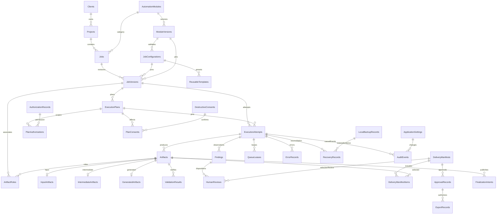
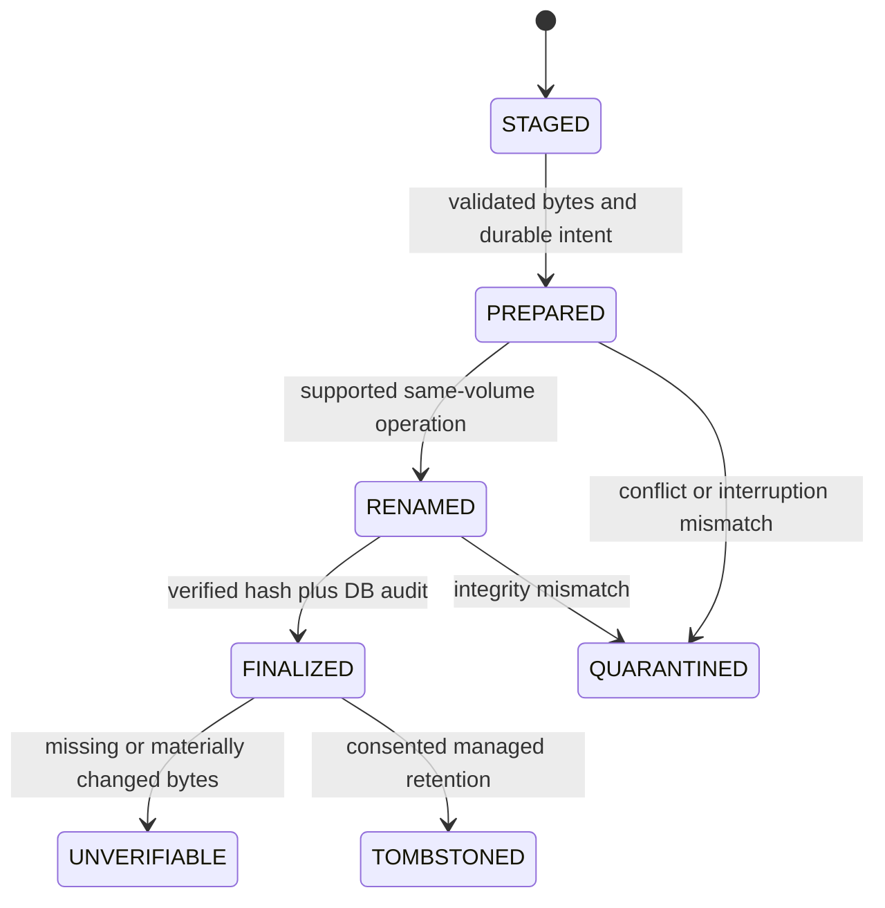

# P3 local persistence, filesystem and artifact design

Status: PROPOSED logical schema, not DDL/migrations. SQLite is the preferred candidate in [ADR-0003](../adr/ADR-0003-local-persistence.md), not adopted. [Artifact-finalization ADR](../adr/ADR-0005-artifact-finalization.md) is unapproved. Entities below cover all 21 requested areas plus normalized supporting relationships. [Components](P3-system-components.md) define semantic owners; L alone executes DB writes. O-07/O-08 and actual SQLite provider/version/license remain open.

## Logical schema conventions
Primary keys: explicitly named opaque stable IDs (candidate UUID) below, except declared composite association keys and module identifiers; no row-number identity exposed as authorization. Artifact subtype primary key is artifactId/FK, ArtifactRoles uses association ID plus unique association tuple, DeliveryManifestItems uses manifestId/artifactId plus unique relativePackageName. Timestamps UTC; revision/epoch optimistic concurrency; hashes SHA-256 plus algorithm field for evolution. FKs enforced per connection; delete restrict for provenance/approvals, no cascading client/project delete into originals or evidence. References missing after explicitly consented purge are retained as typed tombstones, never represented as valid artifacts.

Configuration payload is versioned structured data because module schemas vary; this is an intentional bounded exception to column normalization, validated by Q and indexed only for stable lookup keys, not unbounded EAV. Artifact metadata has one base row with role/subtype details to avoid conflicting copies of path/hash. Denormalized counts/current status are read projections/rebuildable caches with source version; not alternative approval truth. No secret values in these tables.

## Entity — Clients
- Purpose / important attributes: Local client identity; displayName, optional notes, archivedAt, revision.
- Primary key: clientId.
- Relationships / referential integrity / constraints: Referenced by Projects; required nonblank name; no mandatory external account; restrict deletion while referenced.
- Relevant indexes: archivedAt and normalized displayName lookup; names not globally unique (candidate indexes; workload proof pending).
- Lifecycle / retention: Active/archive; no implicit job/evidence deletion; no invented retention duration; owner sets local policy.
- Ownership: COM-B semantic owner; COM-L persists and enforces constraints.
- Associated requirements: REQ-0002; [trace register](../test-matrix/P3-architecture-coverage.md).

## Entity — Projects
- Purpose / important attributes: Client workspace context; clientId, name, approvedRootRef, archivedAt, revision.
- Primary key: projectId.
- Relationships / referential integrity / constraints: Client FK; required name; controlled local workspace reference; no path chosen by worker.
- Relevant indexes: clientId/name, archivedAt (candidate indexes; workload proof pending).
- Lifecycle / retention: Retain historical path mapping; workspace changes affect future versions only; no invented retention duration; owner sets local policy.
- Ownership: COM-B semantic owner; COM-L persists and enforces constraints.
- Associated requirements: REQ-0003; [trace register](../test-matrix/P3-architecture-coverage.md).

## Entity — Jobs
- Purpose / important attributes: Logical editable job identity; projectId, moduleId, currentDraftVersionId, createdAt.
- Primary key: jobId.
- Relationships / referential integrity / constraints: Project/module FK; immutable ID; current draft must belong to this job.
- Relevant indexes: projectId/createdAt and moduleId (candidate indexes; workload proof pending).
- Lifecycle / retention: Archive independently of attempts; delete only consented managed records; no invented retention duration; owner sets local policy.
- Ownership: COM-D semantic owner; COM-L persists and enforces constraints.
- Associated requirements: REQ-0004 REQ-0024; [trace register](../test-matrix/P3-architecture-coverage.md).

## Entity — JobVersions
- Purpose / important attributes: Immutable executed job revision; jobId, versionNumber, configId, moduleVersionId, readiness.
- Primary key: jobVersionId.
- Relationships / referential integrity / constraints: Job/config/moduleVersion FKs; unique jobId/versionNumber; executed config never mutated.
- Relevant indexes: jobId/versionNumber (candidate indexes; workload proof pending).
- Lifecycle / retention: Draft editable under revision check; execution freezes; superseded history retained; no invented retention duration; owner sets local policy.
- Ownership: COM-D semantic owner; COM-L persists and enforces constraints.
- Associated requirements: REQ-0009 REQ-0015; [trace register](../test-matrix/P3-architecture-coverage.md).

## Entity — ExecutionAttempts
- Purpose / important attributes: One execution; jobVersionId, planId, parentAttemptId, phase, outcome, startedAt, endedAt, leaseEpoch, revision.
- Primary key: attemptId.
- Relationships / referential integrity / constraints: Version/plan FKs, plan belongs to that version; parent attempt linked and valid; terminal outcome immutable; end/time/phase checks.
- Relevant indexes: jobVersionId/start, phase, parentAttemptId (candidate indexes; workload proof pending).
- Lifecycle / retention: Nonterminal restart reconciles; terminal attempts never reset; retention preserves audit linkage; no invented retention duration; owner sets local policy.
- Ownership: COM-D semantic owner; COM-L persists and enforces constraints.
- Associated requirements: REQ-0011 REQ-0013 REQ-0016; [trace register](../test-matrix/P3-architecture-coverage.md).

## Entity — AutomationModules
- Purpose / important attributes: Stable module identity; moduleId, name, availabilityReason.
- Primary key: moduleId.
- Relationships / referential integrity / constraints: moduleId unique; four initial registered identities; module versions FK children.
- Relevant indexes: moduleId unique, availability (candidate indexes; workload proof pending).
- Lifecycle / retention: Deactivate unsupported module without deleting its history; no invented retention duration; owner sets local policy.
- Ownership: COM-G semantic owner; COM-L persists and enforces constraints.
- Associated requirements: REQ-0006 REQ-0032; [trace register](../test-matrix/P3-architecture-coverage.md).

## Entity — ModuleVersions
- Purpose / important attributes: Pinned capability package; moduleId, semanticVersion, contractMajor, packageDigest, trustedSource, supportProfile.
- Primary key: moduleVersionId.
- Relationships / referential integrity / constraints: Module FK; unique moduleId/version/digest; adoption approval separate; unknown major rejected.
- Relevant indexes: moduleId/version, packageDigest (candidate indexes; workload proof pending).
- Lifecycle / retention: Immutable historical descriptor; retire/deactivate unsafe version; no invented retention duration; owner sets local policy.
- Ownership: COM-G semantic owner; COM-L persists and enforces constraints.
- Associated requirements: NFR-0010 NFR-0020; [trace register](../test-matrix/P3-architecture-coverage.md).

## Entity — JobConfigurations
- Purpose / important attributes: Schema-validated nonsecret config; schemaVersion, normalizedPayload, configDigest, moduleVersionId.
- Primary key: configId.
- Relationships / referential integrity / constraints: ModuleVersion FK; structured payload validated externally by Q; no code/secrets/client contents; digest recomputed.
- Relevant indexes: moduleVersionId/configDigest (candidate indexes; workload proof pending).
- Lifecycle / retention: Immutable when referenced by executed version; new config on edits; no invented retention duration; owner sets local policy.
- Ownership: COM-Q semantic owner; COM-L persists and enforces constraints.
- Associated requirements: REQ-0007 REQ-0008 REQ-0025; [trace register](../test-matrix/P3-architecture-coverage.md).

## Entity — ReusableTemplates
- Purpose / important attributes: Named versioned preset; templateId, templateVersion, schemaVersion, moduleCompatibility, configId, provenance.
- Primary key: templateVersionId (unique templateId/templateVersion).
- Relationships / referential integrity / constraints: Config FK; unique templateId/templateVersion; compatible schema and no permission inheritance.
- Relevant indexes: name/module and templateId/version (candidate indexes; workload proof pending).
- Lifecycle / retention: Explicit migration creates new version; local import/export sanitized; no invented retention duration; owner sets local policy.
- Ownership: COM-Q semantic owner; COM-L persists and enforces constraints.
- Associated requirements: REQ-0007; [trace register](../test-matrix/P3-architecture-coverage.md).

## Entity — InputArtifacts
- Purpose / important attributes: Input-specific metadata; artifactId, originalPathRef, sourceDigest, snapshotMethod, inspectedProfile.
- Primary key: artifactId (FK).
- Relationships / referential integrity / constraints: One-to-one Artifacts FK; kind input; job version association via artifact roles; snapshot cannot overwrite original.
- Relevant indexes: artifactId unique, sourceDigest (candidate indexes; workload proof pending).
- Lifecycle / retention: Immutable snapshots for confirmed versions; originals outside managed deletion; no invented retention duration; owner sets local policy.
- Ownership: COM-K semantic owner; COM-L persists and enforces constraints.
- Associated requirements: REQ-0005 NFR-0012; [trace register](../test-matrix/P3-architecture-coverage.md).

## Entity — IntermediateArtifacts
- Purpose / important attributes: Working artifact metadata; artifactId, producingStep, completeness, expiryProposal.
- Primary key: artifactId (FK).
- Relationships / referential integrity / constraints: One-to-one Artifacts FK; kind intermediate; attempt FK in base artifact.
- Relevant indexes: attempt step lookup via base; completeness (candidate indexes; workload proof pending).
- Lifecycle / retention: Owned staged output; cleanup only verified owned paths; incomplete never deliverable; no invented retention duration; owner sets local policy.
- Ownership: COM-K semantic owner; COM-L persists and enforces constraints.
- Associated requirements: REQ-0016 NFR-0024; [trace register](../test-matrix/P3-architecture-coverage.md).

## Entity — GeneratedArtifacts
- Purpose / important attributes: Output metadata; artifactId, outputRole, operationProfile, finalizationState.
- Primary key: artifactId (FK).
- Relationships / referential integrity / constraints: One-to-one Artifacts FK; kind generated/evidence/report/package; prepared cannot be approved.
- Relevant indexes: outputRole/finalizationState and artifactId (candidate indexes; workload proof pending).
- Lifecycle / retention: Immutable finalized content; changed content new version/stale approval; no invented retention duration; owner sets local policy.
- Ownership: COM-K semantic owner; COM-L persists and enforces constraints.
- Associated requirements: REQ-0017 REQ-0018; [trace register](../test-matrix/P3-architecture-coverage.md).

## Entity — Findings
- Purpose / important attributes: Observed concern; attemptId, ruleId/version, category, expectedSafe, observedSafe, confidence, artifactRef.
- Primary key: findingId.
- Relationships / referential integrity / constraints: Attempt/artifact FKs; observation not confirmed defect by default; review relationship distinct.
- Relevant indexes: attempt/category/rule; review status projection (candidate indexes; workload proof pending).
- Lifecycle / retention: Append observation; later dispositions separate review history; redact raw secrets; no invented retention duration; owner sets local policy.
- Ownership: COM-I semantic owner; COM-L persists and enforces constraints.
- Associated requirements: REQ-0019 REQ-0050; [trace register](../test-matrix/P3-architecture-coverage.md).

## Entity — ValidationResults
- Purpose / important attributes: Per-check output evidence; artifactId, attemptId, checkId/version, outcome, expectedSafe, observedSafe, evidenceRef.
- Primary key: validationResultId.
- Relationships / referential integrity / constraints: Artifact/attempt FKs; explicit PASSED/FAILED/WARNING/INCONCLUSIVE/NOT_RUN; no empty-suite PASS.
- Relevant indexes: artifactId/check/version, attempt/outcome (candidate indexes; workload proof pending).
- Lifecycle / retention: Immutable run/check record; recheck new row/version; no invented retention duration; owner sets local policy.
- Ownership: COM-I semantic owner; COM-L persists and enforces constraints.
- Associated requirements: REQ-0018; [trace register](../test-matrix/P3-architecture-coverage.md).

## Entity — HumanReviews
- Purpose / important attributes: Human finding/output disposition; reviewerLabel, timestamp, scopeRef, disposition, rationale, evidenceDigest.
- Primary key: reviewId.
- Relationships / referential integrity / constraints: Scoped FK to finding or manifest, exactly one valid scope; eligible-warning rationale required; asserted local identity.
- Relevant indexes: scopeRef/timestamp and reviewerLabel (candidate indexes; workload proof pending).
- Lifecycle / retention: Append-only logical history; never overwrite earlier decision; no invented retention duration; owner sets local policy.
- Ownership: COM-J semantic owner; COM-L persists and enforces constraints.
- Associated requirements: REQ-0019 REQ-0031; [trace register](../test-matrix/P3-architecture-coverage.md).

## Entity — ApprovalRecords
- Purpose / important attributes: Exact final-delivery decision; manifestId, attemptId, reviewerLabel, timestamp, evidenceDigest, decision, invalidationEventId.
- Primary key: approvalId.
- Relationships / referential integrity / constraints: Manifest/attempt FKs; validation/review guards; invalidation event may supersede current status, original immutable.
- Relevant indexes: manifestId/current projection, attempt/timestamp (candidate indexes; workload proof pending).
- Lifecycle / retention: Historical decision retained; current/stale/revoked derived from invalidations/hashes; no invented retention duration; owner sets local policy.
- Ownership: COM-J semantic owner; COM-L persists and enforces constraints.
- Associated requirements: REQ-0020 NFR-0018; [trace register](../test-matrix/P3-architecture-coverage.md).

## Entity — AuditEvents
- Purpose / important attributes: Causal append event; sequence, entityRef, eventType, correlationId, timestamp, safePayload, payloadVersion.
- Primary key: eventId.
- Relationships / referential integrity / constraints: Typed refs or retained tombstones; no credentials/client contents; monotonic logical sequence.
- Relevant indexes: entityRef/sequence, correlationId, timestamp (candidate indexes; workload proof pending).
- Lifecycle / retention: Append-only logically, consented retention with disclosed loss; no tamper-proof claim; no invented retention duration; owner sets local policy.
- Ownership: COM-O semantic owner; COM-L persists and enforces constraints.
- Associated requirements: REQ-0017 NFR-0018; [trace register](../test-matrix/P3-architecture-coverage.md).

## Entity — ErrorRecords
- Purpose / important attributes: Classified safe failure; attemptId optional, code, category, affectedRef, safeCause, diagnosticRef.
- Primary key: errorId.
- Relationships / referential integrity / constraints: Attempt/artifact refs where present; category/code constrained; no silent discard.
- Relevant indexes: attempt/code/time, correlation (candidate indexes; workload proof pending).
- Lifecycle / retention: Retain according to local diagnostic/evidence class and consent; no invented retention duration; owner sets local policy.
- Ownership: COM-O semantic owner; COM-L persists and enforces constraints.
- Associated requirements: REQ-0014 NFR-0022; [trace register](../test-matrix/P3-architecture-coverage.md).

## Entity — RecoveryRecords
- Purpose / important attributes: Reconciliation or retry plan; attemptId, intentId, backupId optional, action, priorFactsDigest, disposition, newAttemptId.
- Primary key: recoveryId.
- Relationships / referential integrity / constraints: Attempt/intent/optional backup FKs; retry references a distinct new attempt; no hidden consent.
- Relevant indexes: attempt/time and unresolved disposition (candidate indexes; workload proof pending).
- Lifecycle / retention: Append recovery facts; do not rewrite failed outcome; no invented retention duration; owner sets local policy.
- Ownership: COM-P semantic owner; COM-L persists and enforces constraints.
- Associated requirements: REQ-0015 REQ-0016; [trace register](../test-matrix/P3-architecture-coverage.md).

## Entity — ApplicationSettings
- Purpose / important attributes: Local effective preference; scope, key, typedValue, schemaVersion, revision.
- Primary key: settingId (unique scope/key).
- Relationships / referential integrity / constraints: Unique scope/key; bounded schema and safe values; secrets referenced outside table.
- Relevant indexes: scope/key unique (candidate indexes; workload proof pending).
- Lifecycle / retention: Revisioned; does not change completed attempts or permission grants; no invented retention duration; owner sets local policy.
- Ownership: COM-Q semantic owner; COM-L persists and enforces constraints.
- Associated requirements: REQ-0025; [trace register](../test-matrix/P3-architecture-coverage.md).

## Entity — LocalBackupRecords
- Purpose / important attributes: Local backup manifest; scope, databaseImageRef, artifactManifestRef, schemaVersion, hashSetDigest, status, locationRef.
- Primary key: backupId.
- Relationships / referential integrity / constraints: Artifact/image refs; complete only after integrity verification; key material excluded.
- Relevant indexes: createdAt/status and manifest digest (candidate indexes; workload proof pending).
- Lifecycle / retention: Consented retention; restore checks versions/hashes/path ownership first; no invented retention duration; owner sets local policy.
- Ownership: COM-R semantic owner; COM-L persists and enforces constraints.
- Associated requirements: REQ-0065 NFR-0011; [trace register](../test-matrix/P3-architecture-coverage.md).

## Entity — Artifacts
- Purpose / important attributes: Normalized base catalog; artifactId, jobId/jobVersionId, attemptId, kind, relativeLocation, createdAt, size, sha256, producer, validationProjection, retentionClass.
- Primary key: artifactId.
- Relationships / referential integrity / constraints: Job/version/attempt FKs as role requires; nonnegative size; unique leased path; hash required for finalized file; input subtype requires source info.
- Relevant indexes: attempt/kind, sha256, jobVersionId, finalization status (candidate indexes; workload proof pending).
- Lifecycle / retention: Managed file status staged/prepared/finalized/missing/tombstoned; metadata and bytes reconciled; no invented retention duration; owner sets local policy.
- Ownership: COM-K semantic owner; COM-L persists and enforces constraints.
- Associated requirements: REQ-0017 NFR-0012; [trace register](../test-matrix/P3-architecture-coverage.md).

## Entity — ArtifactRoles
- Purpose / important attributes: Associate immutable input/output/evidence role to version/attempt; artifactId, jobVersionId, attemptId optional, role.
- Primary key: artifactRoleId with unique association tuple.
- Relationships / referential integrity / constraints: Artifact/version FKs; composite uniqueness by association/role; attempt belongs to version.
- Relevant indexes: version/role, attempt/role (candidate indexes; workload proof pending).
- Lifecycle / retention: References retained until consented purge; no duplicate file bytes implied; no invented retention duration; owner sets local policy.
- Ownership: COM-K semantic owner; COM-L persists and enforces constraints.
- Associated requirements: REQ-0017; [trace register](../test-matrix/P3-architecture-coverage.md).

## Entity — FinalizationIntents
- Purpose / important attributes: Recoverable file/DB publication; artifactId, tempRelativePath, finalRelativePath, expectedHash/size, leaseId, phase.
- Primary key: intentId.
- Relationships / referential integrity / constraints: Artifact FK; unique intent ID and output lease; proposed hash/version match; legal phase transitions.
- Relevant indexes: unresolved phase, artifactId unique active (candidate indexes; workload proof pending).
- Lifecycle / retention: Prepared metadata before rename; reconciled after restart; no guessed final status; no invented retention duration; owner sets local policy.
- Ownership: COM-K semantic owner; COM-L persists and enforces constraints.
- Associated requirements: NFR-0011 REQ-0017; [trace register](../test-matrix/P3-architecture-coverage.md).

## Entity — QueueLeases
- Purpose / important attributes: Local durable dispatch identity; attemptId, leaseEpoch, processToken, expiry, outputReservation.
- Primary key: leaseId.
- Relationships / referential integrity / constraints: Attempt FK; one active lease per attempt/output target; stale epoch rejected.
- Relevant indexes: attempt unique active and expiry (candidate indexes; workload proof pending).
- Lifecycle / retention: Released on terminal/restart; no same PID assumed after reboot; no invented retention duration; owner sets local policy.
- Ownership: COM-E semantic owner; COM-L persists and enforces constraints.
- Associated requirements: REQ-0029; [trace register](../test-matrix/P3-architecture-coverage.md).

## Entity — AuthorizationRecords
- Purpose / important attributes: Website permission declaration; target origins/paths/methods/actions, syntheticDataProfile, expiry, permissionEvidenceRef, revision.
- Primary key: authorizationId.
- Relationships / referential integrity / constraints: Valid bounded scope; no credentials/plain client files; referenced by confirmed plan.
- Relevant indexes: expiry, scopeDigest (candidate indexes; workload proof pending).
- Lifecycle / retention: Revoke/expire; every actual network action rechecks; history retained; no invented retention duration; owner sets local policy.
- Ownership: COM-S semantic owner; COM-L persists and enforces constraints.
- Associated requirements: REQ-0028 REQ-0030; [trace register](../test-matrix/P3-architecture-coverage.md).

## Entity — DestructiveConsents
- Purpose / important attributes: Scoped human confirmation; action, exactTargetRefs, planDigest, reviewerLabel, timestamp, expiry.
- Primary key: destructiveConsentId.
- Relationships / referential integrity / constraints: Current plan/targets only; no reusable template consent; destination changed invalidates.
- Relevant indexes: planDigest/action and target (candidate indexes; workload proof pending).
- Lifecycle / retention: New effect requires fresh consent; retained decision history; no invented retention duration; owner sets local policy.
- Ownership: COM-S semantic owner; COM-L persists and enforces constraints.
- Associated requirements: REQ-0010; [trace register](../test-matrix/P3-architecture-coverage.md).

## Entity — DeliveryManifests
- Purpose / important attributes: Immutable selected artifact-set; attemptId, version, selectionDigest, validationEvidenceDigest, reviewDigest.
- Primary key: manifestId.
- Relationships / referential integrity / constraints: Attempt FK; nonempty eligible selected set; entries normalized below; no unapproved secrets/raw inputs by default.
- Relevant indexes: attempt/version, selectionDigest (candidate indexes; workload proof pending).
- Lifecycle / retention: New selection/bytes yields new manifest; stale approval retained; no invented retention duration; owner sets local policy.
- Ownership: COM-N semantic owner; COM-L persists and enforces constraints.
- Associated requirements: REQ-0022 REQ-0020; [trace register](../test-matrix/P3-architecture-coverage.md).

## Entity — DeliveryManifestItems
- Purpose / important attributes: Per-file approved selection; manifestId, artifactId, relativePackageName, size, sha256.
- Primary key: (manifestId, artifactId).
- Relationships / referential integrity / constraints: Manifest/artifact FK; unique package name; hash/size match finalized current source; safe relative name.
- Relevant indexes: manifest/name unique, artifactId (candidate indexes; workload proof pending).
- Lifecycle / retention: Immutable manifest membership; collision unresolved blocks packaging; no invented retention duration; owner sets local policy.
- Ownership: COM-N semantic owner; COM-L persists and enforces constraints.
- Associated requirements: REQ-0022; [trace register](../test-matrix/P3-architecture-coverage.md).

## Entity — ExportRecords
- Purpose / important attributes: Local export occurrence; manifestId, approvalId, packageArtifactId, destinationRef, result, actualHashes, errorRef.
- Primary key: exportId.
- Relationships / referential integrity / constraints: Manifest/approval/artifact FKs; EXPORTED requires verified package/source and current approval at export.
- Relevant indexes: manifest/time, approval/time, result (candidate indexes; workload proof pending).
- Lifecycle / retention: Append exports/repackages; no automatic delivery or remote publish; no invented retention duration; owner sets local policy.
- Ownership: COM-N semantic owner; COM-L persists and enforces constraints.
- Associated requirements: REQ-0023; [trace register](../test-matrix/P3-architecture-coverage.md).

## Entity — ExecutionPlans
- Purpose / important attributes: Immutable execution proposal; jobVersionId, planDigest, normalizedSteps/effects, input/configDigest, requiredPermissionProfile, outputLeasePlan, limits/validation profile.
- Primary key: planId.
- Relationships / referential integrity / constraints: JobVersion FK; unique planDigest; current confirmation/consent associated, not inherent permission; attempt pins exact plan.
- Relevant indexes: jobVersionId/planDigest.
- Lifecycle / retention: Created side-effect-free; immutable when confirmed; changed inputs/configuration generate new plan; no invented retention period.
- Ownership: COM-D semantic owner; COM-L persistence.
- Associated requirements: REQ-0009.

## Entity — PlanAuthorizations
- Purpose / important attributes: Normalized plan permission association; planId, authorizationId, requiredActionScopeDigest.
- Primary key: (planId, authorizationId, requiredActionScopeDigest).
- Relationships / referential integrity / constraints: Plan/Authorization FKs; composite unique pair/scope; expiry/revocation rechecked per request.
- Relevant indexes: plan/scope and authorization.
- Lifecycle / retention: Retain historical authorization scope; no grant reuse after invalidation; no invented retention period.
- Ownership: COM-S semantic owner; COM-L persistence.
- Associated requirements: REQ-0028.

## Entity — PlanConsents
- Purpose / important attributes: Normalized destructive effect consent association; planId, destructiveConsentId, targetEffectDigest.
- Primary key: (planId, destructiveConsentId, targetEffectDigest).
- Relationships / referential integrity / constraints: Plan/DestructiveConsent FKs; unique effect association; exact current plan/target; no template inheritance.
- Relevant indexes: plan/targetEffectDigest.
- Lifecycle / retention: Retain historical decision; changed effects require fresh consent; no invented retention period.
- Ownership: COM-S semantic owner; COM-L persistence.
- Associated requirements: REQ-0010.

## Entity relationships

ERD is logical optional association, not permission enforcement or executable SQL. ExecutionPlans and normalized PlanAuthorizations/PlanConsents support multiple scopes/consents per immutable plan; the plan pins version and required effects while grants can expire/revoke independently. HumanReviews scope is exactly one finding/manifest; artifactId may be evidence linked through the manifest. No FK forces external original file availability.

## Transaction correctness
Application owns a single serialized writer; views use read snapshots; workers do not open DB. Candidate SQLite journal mode (WAL vs rollback) and synchronous durability setting require P5 power-loss/workload tests; never disable durability to pass benchmarks. Busy transactions have bounded retry before surfaced DB_BUSY; no blocked UI thread and no hidden retry of external effects. Atomic DB operations include version/attempt/queue lease creation, transition+audit append, review+audit, approval+scope, finalization intent+artifact metadata and verified export record. Filesystem/network effects are not inside a misleading DB transaction.

Schema version and migration journal recorded. Before upgrade: stop dispatch, establish consistent backup and check space; migration executes approved bounded steps in a DB transaction where supported, validates integrity/FKs, commits schema version last. Failed/incompatible migration preserves backup and safe recovery; rollback only through a tested compatible procedure, not assuming old binary can read new schema. No migrations written now. Candidate quick_check/integrity_check and FK checks at scheduled/restore gates; heavy full integrity checks require bounded offline maintenance, not every UI query. Corruption response: stop writes/dispatch, preserve suspected DB/log artifacts, show recovery options and validate known-good backup; never silently create a blank DB as if history intact.

## Controlled local storage areas
| Area | Ownership and proposed access / lifecycle |
| --- | --- |
| Configuration | COM-Q under application-owned local user data; validated nonsecret settings/templates |
| Database | COM-L, local supported filesystem only; no source repo/network-share/cloud sync requirement |
| Client projects | Original source location user-selected, external/read-only by default; reference not cleanup authority |
| Job input snapshots | COM-K per immutable version/attempt; content hashed and readonly to workers; no source mutation |
| Temporary processing | COM-K/F unique random attempt directory, no predictable shared temp name; staged non-deliverable files |
| Execution evidence | COM-K/O registered immutable artifacts with checksums/provenance |
| Generated outputs | COM-K finalization under leased safe relative names; no default overwrite |
| Approved deliverables | COM-N manifest-linked selected output references and local package; approval not inferred from folder |
| Diagnostic logs | COM-O bounded/redacted local files; preview before export |
| Local backups | COM-R local protected verified manifests/DB image/artifact set; key material separated |

Exact Windows base directory/ACL/encryption/retention remain proposals (e.g. user LocalAppData rather than source checkout) requiring P5 verification. File names use stable IDs plus sanitized display name/extension; unique output lease prevents collisions; canonical case-insensitive normalization rejects reserved device names, alternate streams, traversal, rooted/UNC escape, symlink/junction/reparse escape and invalid characters. Compare/operate by verified handles where possible to limit TOCTOU; canonical text comparison alone is insufficient. Exports to user-chosen paths need explicit consent and path validation; network/cloud-synced destinations risk locality and must be disallowed or resolved through owner scope review, never hidden sync.

Snapshots: copy originals into managed readonly snapshot, verify stable size/hash before and after source read; changed-during-copy fails confirmation. Prefer true immutable-by-policy snapshots, but same-user write access is a residual risk until ACL/isolation proven. File size/expanded bytes/count/depth/time limits are operation-profile fields, pending workloads; size estimates include snapshot, staging, evidence, output, backup and destination package. Insufficient space blocks preflight or classifies failed write safely. Cleanup uses registered ownership/leases; only unreferenced owned temps after reconciliation and consented retention; no original or arbitrary path deletion. No confidential client files in source-control fixtures.

## Recoverable artifact-finalization protocol
Candidate sequence evaluated: K holds exclusive artifact output lease; write temp under same-volume managed staging; isolated parse/output checks and streaming checksum; durable prepared intent records expected size/hash/temp/final paths+attempt; rename into unused reserved final name where filesystem atomic rename is supported; verify final hash/size; commit finalized metadata+audit; release lease. Approval requires finalized bytes, all validation evidence and current manifest hashes. If later validation reopens a file, it must verify current digest against intent. DB and filesystem have no shared atomic transaction: this is recoverability, not a single ACID cross-store commit. Atomic visibility differs from crash/power-loss durability; flush/rename/volume behavior must be measured on actual Windows filesystem.

| Restart observation | Deterministic reconciliation / approval disposition |
| --- | --- |
| Temp only, no prepared intent | Orphan owned temp; quarantine/inspect then cleanup under policy, never deliver |
| Prepared intent + temp, no final | Verify expected hash/size then complete only safe current intent; otherwise quarantine/report failure |
| Prepared intent + matching final | Commit final metadata idempotently if lease/plan ownership consistent; never grant approval |
| Prepared intent + mismatching final | Integrity conflict; quarantine non-destructively, block affected outputs/approval |
| DB finalized but file missing/different | Mark unavailable/unverifiable and append invalidation; retain historical facts |
| Both temp and final | Matching expected final reconciles; temp cleanup only verified ownership; different bytes remain conflict |
| Cross-volume/external export path | Stage on destination volume where supported; otherwise document weaker protocol and no atomicity claim; incomplete export never EXPORTED |

## Backup/restore consistency
COM-R pauses new dispatch/finalization, drains or stops active writers, obtains a consistent DB snapshot through SQLite's supported backup API (candidate) and selects the referenced finalized artifact manifest; never copies an active DB/WAL pair blindly. Copy stable files, verify image integrity/FKs/all included hashes, record schema/module/profile inventory and exclusions, then mark backup complete. Temporary/partial outputs excluded or explicitly recorded as incomplete, not an approved snapshot. Secure local path/ACLs and candidate encryption protect backup; key storage/loss handling pending security review.

Restore is staged and consented: verify manifest/schema/version, DB integrity/FKs, file hashes, path confinement and free space; preserve current state as backup; stop dispatch/owned processes; replace only managed areas with recoverable intent; reconcile references/leases; rehash delivered selections and mark approvals stale until required review. Original external inputs are not overwritten; unavailable originals marked missing. Restoration does not recover an external account or claim tamper-proof identity. Every backup/restore result records included/excluded/missing artifacts and actual integrity results. All future tests NOT_RUN.
