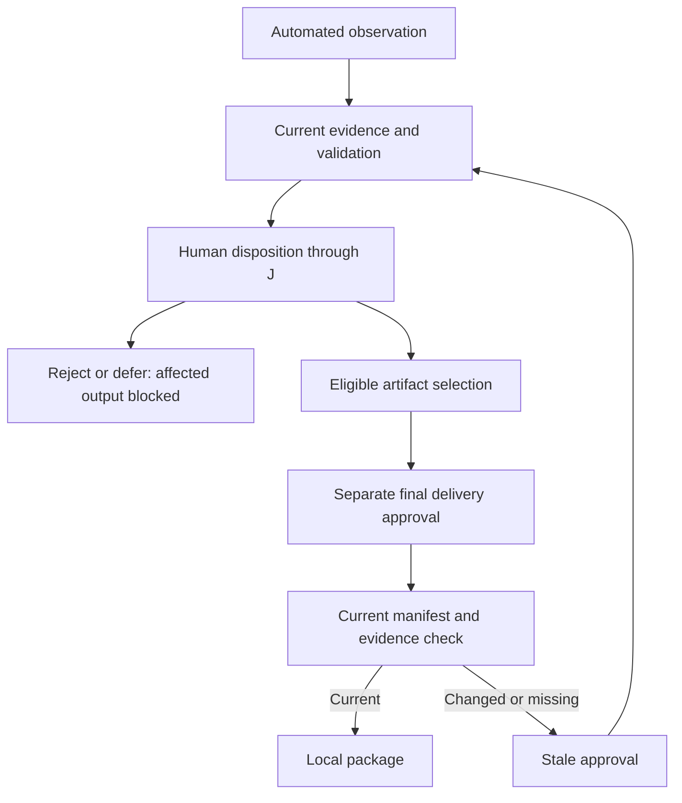
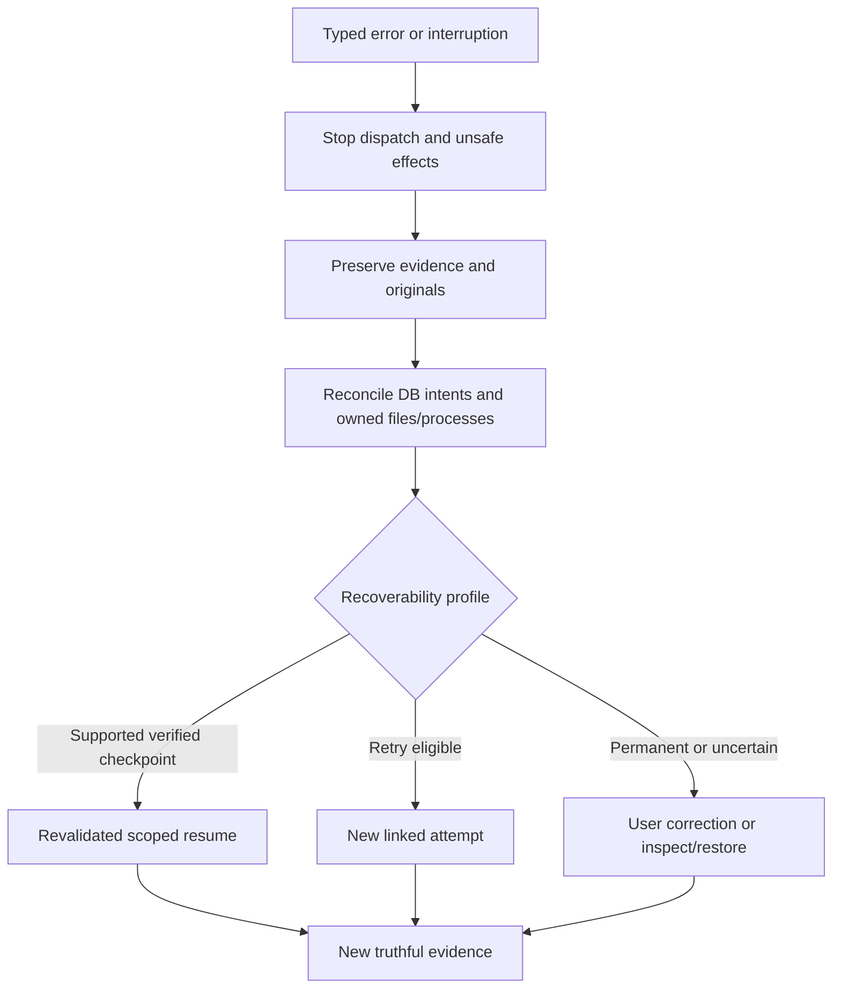

# P3 recovery and human approval guards

Status: PROPOSED. COM-P classifies recovery; COM-D owns attempt transitions; COM-J alone records human disposition/approval. [Worker/lifecycle](P3-job-worker-protocol.md), [persistence](P3-persistence-artifacts.md), [P2 failure UX](P2-failure-recovery.md) and [report contracts](P3-reporting-packaging.md) must agree. REQ-0010/0013 through REQ-0023/0031; NFR-0003/0011/0012/0018/0022.

## Standard error taxonomy
Every error has errorId, stable code, category, severity, attempt/job/correlation IDs where applicable, affected item/artifact/scope, safe user cause/next action, restricted redacted diagnostic ref, retryClass, recoveryAction, occurredAt and audit reference. External library errors map here, not raw exceptions in UI. User explanation always states happened/affected/next. Cleanup below means only registered owned temps/processes; preservation/invalidation applies before any cleanup.

| Category / code | User-facing explanation / diagnostics | Retry eligibility / recovery | Cleanup and audit |
| --- | --- | --- | --- |
| Invalid input / INPUT_INVALID | Invalid field/range/type, affected selection; validator/rule refs, safe location | User correction then new validated plan; no unchanged retry | Preserve draft/snapshot; audit rejection |
| Unsupported file / UNSUPPORTED_INPUT | Feature/format not supported; profile/module version | Choose supported operation/input; feasibility decision needed | No original modification; audit capability limitation |
| Missing permission / PERMISSION_DENIED | Exact action/path unavailable; safe OS error class | Reauthorize/rechoose allowed path; never elevate automatically | Release owned lease if aborted; audit denial |
| Corrupt file / INPUT_CORRUPT | Parser cannot inspect declared input; artifact/hash/error class | Replace input or supported investigation; unchanged malformed input not transient | Quarantine owned staging, retain original; audit parse failure |
| Database / DB_BUSY or DB_CORRUPT | Durable record unavailable or integrity failed; safe schema/check refs | Busy bounded retry; corruption halts writes and validated restore | No blank-history fallback; preserve suspect DB; audit via safe fallback until durable recovery |
| Worker startup / WORKER_START_FAILED | Trusted component could not initialize; package/exit/protocol refs | Retry only diagnosed transient start issue with valid capability | Stop owned tree/release lease; preserve startup evidence |
| Worker crash / WORKER_CRASH | Execution stopped; affected attempt/items | New linked attempt after diagnosis; resume only declared checkpoint | Reconcile staged intents; preserve evidence; audit exit token/code |
| Timeout / EXECUTION_TIMEOUT | Operation/deadline exceeded; elapsed/limit/last activity | Idempotent bounded retry only if profile permits and authorization current | Cancel then owned-tree termination; no incomplete ready output |
| Cancellation / USER_CANCELLED | User requested stop; actual finished/partial/cancel facts | New linked attempt if desired; no automatic rerun | Preserve item dispositions; audit cancel request/ack/terminal separately |
| Storage / STORAGE_EXHAUSTED | Output/evidence/package write affected; safe path/estimate | User supplies safe space/destination, revalidate | No automatic deleting originals/other data; incomplete staged bytes never approved |
| Resource exhaustion / RESOURCE_LIMIT | Memory/count/expanded-byte/process limit exceeded; measured safe limit refs | Smaller scope/revised approved limits, not same unbounded rerun | Terminate owned execution safely; preserve reconciliation evidence |
| Network / NETWORK_FAILURE | Timeout/DNS/TLS/connectivity event and affected request | Bounded idempotent authorized retry; no TLS bypass or uncontrolled posting | Close owned browser/session; redact credentials and record request disposition |
| Website authorization / TARGET_UNAUTHORIZED | Expired/out-of-scope target/action/redirect | Correct permission/scope with fresh confirmation; no forbidden request | Audit denial; no fallback network path |
| Validation / OUTPUT_INVALID | Expected vs observed failed/uncertain check; artifact/check IDs | Reverify only after corrected facts or new output; human cannot relabel known fail PASSED | Invalidate affected eligibility, retain failed evidence |
| Export / EXPORT_FAILURE | Actual partial files/destination, source hashes retained | New local target/name or safe retry with current approval | Cleanup only consented owned partial export; append failed export record |

Transient retry counters/deadlines are proposed configuration fields; no arbitrary infinite retries. A retry is new attempt/output version when processing reruns, preserving parent link, input/module/config identity and consent/permission rechecks. Irreversible website action cannot be retried automatically merely because its response was lost; outcome is inconclusive and requires human inspection.

## Formal review architecture
Observation is recorded by module/validation with confidence/context/evidence. It may become CONFIRMED finding, DISMISSED finding, ACCEPTED_WARNING, REJECTED or DEFERRED only through COM-J with explicit local reviewer label, timestamp, evidence version/hash, scope and rationale. Asserted local identity does not prove independently authenticated person or separation of duties (O-05). No module/worker completion flag can call approval directly; only an explicit B review use case can obtain J domain guard.

ApprovalRecord binds approvalId, attempt/jobVersion, exact DeliveryManifest selectionDigest, each artifact hash/size, validation/review evidenceDigest, reviewer label/time, scope (final client package), decision and invalidation history. Record publication+audit is transactional; failed save leaves unapproved. Re-review required when material output/selection/config evidence changes, evidence becomes unavailable or required validation is invalidated. Unrelated UI preference edits do not invalidate unchanged historical outcomes. Changed files produce a new artifact/version/manifest; do not overwrite approval history. Audit logical append-only plus hashes is detectable integrity, not proof against an attacker with write access to DB/files.

Eligible uncertainty can be accepted with rationale according to approved profile; known failed checks remain FAILED. A confirmed defect may be valid report content if the report/evidence itself satisfies delivery requirements; it does not mean the tested website passed. A provisional suspected defect stays labeled unverified even if its diagnostic report is locally saved. Independently valid subset delivery remains an open owner interpretation; exact exclusions and overall failed/partial outcome remain visible.

## Verification prerequisites
Restart at prepare/rename/commit, rollback with changed file, cancel/completion races, retry of lost nonidempotent response, missing logs/DB evidence, stale approval export, consent rejection and restored backup integrity. No runtime/fault injection performed. [P3 future cases](../test-matrix/P3-architecture-coverage.md).
