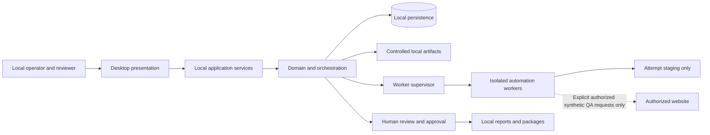
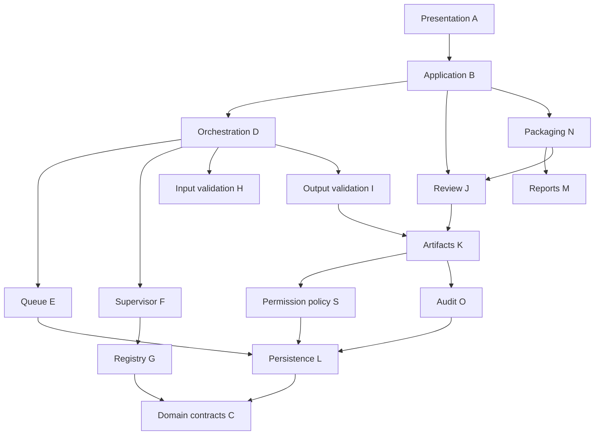

# P3 system context and component architecture

Status: PROPOSED. [Architecture book](../governance/03-architecture-book.md) owns overall rationale; [ADR-0001](../adr/ADR-0001-modular-platform.md) proposes a modular monolith with isolated job workers. Diagram edges are allowed logical communication; code dependencies use lower-level contracts/ports and remain acyclic. Named public interfaces below are conceptual contracts, not executable code.

## Context and alternatives
Single local desktop platform owns client/project/job records, with disposable bounded workers for parsing/automation. No distributed broker, cloud DB, microservice or network daemon. Compared with an all-in-process design, workers improve crash/resource containment but add IPC/persistence recovery cost; compared with service/microservice architecture, this reduces deployment/attack surface and keeps local use offline. A single executable/library worker mode or separately packaged worker host are alternatives pending P5. Isolation is not a verified sandbox.

## Allowed layer communication
Presentation calls Application Services only. Application coordinates domain and ports; Domain is pure and references no UI, DB, OS or module internals. Infrastructure adapters implement persistence/artifact/process/network ports. Workers see serialized contracts and scoped handles/paths, never application database, approval API or another module's data. Backend events return through validated supervisor notifications, not direct UI mutation. No desktop control can pass an arbitrary command string to the OS. Library references follow the explicit dependency DAG below; callbacks/events are contract messages and do not add reverse code references.

Each component has one semantic owner; L persists the records but does not own their business decisions. File and database state reconciliation belongs K/P with D coordinating lifecycle. Module-specific input/output validation adapters supply predicates; H/I own shared invocation/result semantics. G reads manifests through a composition-supplied registry port; it does not acquire a reverse dependency on application services. H/I request safe worker work through invocation ports supplied by D; they do not own dispatch or depend on F.

Diagram is a readable subset of the full DAG; the dependency rows below are authoritative. OS APIs are infrastructure adapters, not extra cross-component authorities. Shared services are these platform components, not four independent copies inside modules.

## COM-A — Desktop Presentation
- Primary responsibility: Render P2 views and user intent.
- Inputs: Read models, form values, explicit consent.
- Outputs: Typed commands and accessible status views.
- Public interfaces: QueryView; SubmitIntent.
- Owned data: Transient edit/focus state only.
- Dependencies: COM-B; immutable shared contracts only; no hidden reverse calls.
- Failure scenarios: Unavailable view/save; keep edits and show safe error.
- Security boundaries: No shell/OS commands, database writes, raw worker or network access.
- Associated requirements: REQ-0001, REQ-0004, NFR-0008; conditional SRS status; [architecture trace](../test-matrix/P3-architecture-coverage.md).

## COM-B — Application Services
- Primary responsibility: Coordinate use cases, enforce authorization context.
- Inputs: Validated UI command with expected revision.
- Outputs: Result/read model and operation correlation.
- Public interfaces: CreateDraft; PlanJob; StartJob; Review; Export; ManageData.
- Owned data: Use-case request/idempotency context.
- Dependencies: COM-C, COM-D, COM-J, COM-L, COM-M, COM-N, COM-P, COM-Q, COM-R, COM-S; immutable shared contracts only; no hidden reverse calls.
- Failure scenarios: Stale command, invalid state or unavailable persistence.
- Security boundaries: Single authenticated local-session intent boundary; no assumed external identity.
- Associated requirements: REQ-0002, REQ-0003, REQ-0025, REQ-0026; conditional SRS status; [architecture trace](../test-matrix/P3-architecture-coverage.md).

## COM-C — Domain and Business Rules
- Primary responsibility: Pure invariants and state/approval eligibility.
- Inputs: Immutable entities/value objects and facts.
- Outputs: Decision or typed invariant rejection.
- Public interfaces: ValidateTransition; DeliveryEligibility; ReconcileCounts.
- Owned data: Definitions/invariants, not mutable external data.
- Dependencies: none; immutable shared contracts only; no hidden reverse calls.
- Failure scenarios: Rejected state or unmet invariant.
- Security boundaries: No filesystem/network/process access or runtime AI.
- Associated requirements: REQ-0020, REQ-0029, NFR-0019; conditional SRS status; [architecture trace](../test-matrix/P3-architecture-coverage.md).

## COM-D — Job Orchestration
- Primary responsibility: Drive durable attempts through guarded phases.
- Inputs: Confirmed version/plan and bounded worker events.
- Outputs: Attempt transitions and commands.
- Public interfaces: Preflight; Enqueue; HandleEvent; ReconcileRestart.
- Owned data: Attempt lifecycle policy; persisted via L.
- Dependencies: COM-C, COM-E, COM-F, COM-G, COM-H, COM-I, COM-K, COM-L, COM-O, COM-P, COM-S; immutable shared contracts only; no hidden reverse calls.
- Failure scenarios: Timeout/crash/stale event; fail/interruption with evidence.
- Security boundaries: Workers cannot choose approval or transition durable job state.
- Associated requirements: REQ-0011, REQ-0012, REQ-0013, REQ-0016; conditional SRS status; [architecture trace](../test-matrix/P3-architecture-coverage.md).

## COM-E — Local Job Queue
- Primary responsibility: Persist eligible pending attempt order/leases.
- Inputs: Validated immutable queue request.
- Outputs: Bounded dispatch lease/queue status.
- Public interfaces: EnqueueUnique; LeaseNext; ReleaseLease.
- Owned data: Queue ordering and leases in L.
- Dependencies: COM-C, COM-L; immutable shared contracts only; no hidden reverse calls.
- Failure scenarios: Stale lease, duplicate dispatch or DB unavailable.
- Security boundaries: No broker/network service; no executing jobs itself.
- Associated requirements: REQ-0029, REQ-0011, NFR-0013; conditional SRS status; [architecture trace](../test-matrix/P3-architecture-coverage.md).

## COM-F — Worker Process Supervisor
- Primary responsibility: Launch trusted worker and contain lifecycle.
- Inputs: Registry version, plan, capability grant, limits.
- Outputs: Validated events and process exit facts.
- Public interfaces: StartTrustedWorker; SendCancel; ObserveExit.
- Owned data: Process/session/heartbeat runtime records.
- Dependencies: COM-C, COM-G, COM-K, COM-O, COM-S; immutable shared contracts only; no hidden reverse calls.
- Failure scenarios: Startup/IPC/crash/resource failures; kill owned process tree safely.
- Security boundaries: Fixed trusted binary/arguments; proposed restricted token/job objects; not a proven sandbox.
- Associated requirements: REQ-0013, REQ-0014, NFR-0004, NFR-0011; conditional SRS status; [architecture trace](../test-matrix/P3-architecture-coverage.md).

## COM-G — Automation Module Registry
- Primary responsibility: Expose compatible trusted module capabilities.
- Inputs: Packaged module manifest/version/digest.
- Outputs: Validated descriptor or unavailable capability.
- Public interfaces: ResolvePinnedModule; ListCapabilities.
- Owned data: Module/version manifests via application persistence port.
- Dependencies: COM-C; immutable shared contracts only; no hidden reverse calls.
- Failure scenarios: Missing/incompatible/untrusted module.
- Security boundaries: No arbitrary plugin loading, imported code or cross-module private access.
- Associated requirements: REQ-0006, REQ-0032, NFR-0010; conditional SRS status; [architecture trace](../test-matrix/P3-architecture-coverage.md).

## COM-H — Input Validation
- Primary responsibility: Check schema/access/declared support safely.
- Inputs: Input snapshot metadata and module config.
- Outputs: Validation findings and plan prerequisites.
- Public interfaces: ValidateInputs; ValidateConfiguration.
- Owned data: Validation result definitions; records persisted by D.
- Dependencies: COM-C, COM-G; immutable shared contracts only; no hidden reverse calls.
- Failure scenarios: Malformed/unsupported/ambiguous input.
- Security boundaries: Untrusted parse work runs through isolated worker capability, never executes macros.
- Associated requirements: REQ-0008, REQ-0033, REQ-0051; conditional SRS status; [architecture trace](../test-matrix/P3-architecture-coverage.md).

## COM-I — Output Validation
- Primary responsibility: Apply declared checks independently of worker success.
- Inputs: Prepared output handles/metadata and expected properties.
- Outputs: Per-check outcomes and evidence.
- Public interfaces: VerifyOutputSet; ReconcileData.
- Owned data: Validation findings; persisted by D.
- Dependencies: COM-C, COM-G, COM-K; immutable shared contracts only; no hidden reverse calls.
- Failure scenarios: Unreadable/mismatched/inconclusive output.
- Security boundaries: Checks may use isolated verifier operation; worker success cannot approve output.
- Associated requirements: REQ-0018, REQ-0058, NFR-0003; conditional SRS status; [architecture trace](../test-matrix/P3-architecture-coverage.md).

## COM-J — Human Review and Approval
- Primary responsibility: Record dispositions and exact final artifact-set approval.
- Inputs: Current findings/artifact hashes and explicit reviewer intent.
- Outputs: Immutable review/approval or stale rejection.
- Public interfaces: RecordReview; ApproveSelection; Invalidate.
- Owned data: Review/history/approval records in L.
- Dependencies: COM-C, COM-K, COM-L, COM-O; immutable shared contracts only; no hidden reverse calls.
- Failure scenarios: Missing/stale evidence or failed validation.
- Security boundaries: Only explicit local human intent; modules cannot grant approval.
- Associated requirements: REQ-0019, REQ-0020, REQ-0031, NFR-0018; conditional SRS status; [architecture trace](../test-matrix/P3-architecture-coverage.md).

## COM-K — Artifact and File Management
- Primary responsibility: Own workspace paths, snapshots, staged writes and finalization.
- Inputs: Bounded artifact request/capability.
- Outputs: Registered artifact metadata/leased handles.
- Public interfaces: SnapshotInput; PrepareArtifact; Finalize; VerifyHash.
- Owned data: Artifact catalog/finalization intents in L; managed files.
- Dependencies: COM-C, COM-L, COM-O, COM-S; immutable shared contracts only; no hidden reverse calls.
- Failure scenarios: Disk/path/hash/rename failure.
- Security boundaries: Reject escape/reparse paths; originals readonly; no silent overwrite.
- Associated requirements: REQ-0017, NFR-0012, NFR-0024; conditional SRS status; [architecture trace](../test-matrix/P3-architecture-coverage.md).

## COM-L — Local Persistence
- Primary responsibility: Commit entities with concurrency and consistency rules.
- Inputs: Typed repository operation/transaction.
- Outputs: Durable records or typed DB failure.
- Public interfaces: ReadSnapshot; CommitExpectedRevision; BackupDatabase.
- Owned data: All logical persisted records, schema/version.
- Dependencies: COM-C; immutable shared contracts only; no hidden reverse calls.
- Failure scenarios: Busy/corrupt/full/migration failure; no success fabrication.
- Security boundaries: Application-only writer; workers never open DB; no cloud connector.
- Associated requirements: REQ-0024, NFR-0011, NFR-0016; conditional SRS status; [architecture trace](../test-matrix/P3-architecture-coverage.md).

## COM-M — Report Generation
- Primary responsibility: Project immutable evidence into supported reports.
- Inputs: Versioned report-data contracts and artifact references.
- Outputs: Staged report/limitations.
- Public interfaces: BuildExecutionReport; RenderSupportedFormat.
- Owned data: Report schema/render profiles; artifacts via K.
- Dependencies: COM-C, COM-K, COM-L; immutable shared contracts only; no hidden reverse calls.
- Failure scenarios: Template/render/font/fidelity errors.
- Security boundaries: Encode HTML, redact secrets, no active content or external assets.
- Associated requirements: REQ-0021, REQ-0050, NFR-0005; conditional SRS status; [architecture trace](../test-matrix/P3-architecture-coverage.md).

## COM-N — Delivery Packaging
- Primary responsibility: Package only current approved artifact sets.
- Inputs: Approval reference, manifest and local destination.
- Outputs: Verified local package/export record.
- Public interfaces: PlanPackage; BuildPackage; ExportLocal.
- Owned data: Package/export records in L.
- Dependencies: COM-C, COM-J, COM-K, COM-L, COM-M, COM-O; immutable shared contracts only; no hidden reverse calls.
- Failure scenarios: Collision/partial/export/hash failure.
- Security boundaries: Rechecks approval and source hashes; no external delivery/deployment.
- Associated requirements: REQ-0022, REQ-0023, REQ-0067; conditional SRS status; [architecture trace](../test-matrix/P3-architecture-coverage.md).

## COM-O — Audit and Diagnostics
- Primary responsibility: Record safe causal events and diagnostic read models.
- Inputs: Typed safe event/correlation/redaction classification.
- Outputs: Append-only logical event or surfaced logging failure.
- Public interfaces: AppendAudit; RecordDiagnostic; PreviewLocalExport.
- Owned data: Audit/error-safe diagnostics in L and bounded local logs.
- Dependencies: COM-C, COM-L; immutable shared contracts only; no hidden reverse calls.
- Failure scenarios: DB/log write failure; explicit unavailable evidence.
- Security boundaries: Never credentials/raw client contents; local only; checksum is not tamper-proof proof.
- Associated requirements: REQ-0014, REQ-0017, NFR-0022; conditional SRS status; [architecture trace](../test-matrix/P3-architecture-coverage.md).

## COM-P — Error and Recovery
- Primary responsibility: Classify failures and propose safe reconciliation steps.
- Inputs: Typed error + prior durable/file facts.
- Outputs: Recoverability decision/action proposal.
- Public interfaces: ClassifyError; PlanRecovery; ReconcileIntent.
- Owned data: Recovery records via L, no independent job approval.
- Dependencies: COM-C, COM-K, COM-L, COM-O; immutable shared contracts only; no hidden reverse calls.
- Failure scenarios: Unresolvable corruption or unsupported resume.
- Security boundaries: No automatic destructive retry or consent reuse.
- Associated requirements: REQ-0015, REQ-0016, NFR-0011; conditional SRS status; [architecture trace](../test-matrix/P3-architecture-coverage.md).

## COM-Q — Configuration and Templates
- Primary responsibility: Validate/version nonexecutable saved configuration.
- Inputs: Structured schema-bounded rules/import template.
- Outputs: Compatible normalized config or explicit error.
- Public interfaces: SaveTemplateVersion; ApplyTemplateDiff; MigrateConfig.
- Owned data: Templates/settings/job config in L.
- Dependencies: COM-C, COM-G, COM-L, COM-S; immutable shared contracts only; no hidden reverse calls.
- Failure scenarios: Obsolete schema/import/secret contamination.
- Security boundaries: No code/scripts, stored client data or inherited permission grants.
- Associated requirements: REQ-0007, REQ-0025, NFR-0004; conditional SRS status; [architecture trace](../test-matrix/P3-architecture-coverage.md).

## COM-R — Local Backup and Restore
- Primary responsibility: Produce consistent recoverable local snapshots.
- Inputs: Selected scope, quiescence and backup consent.
- Outputs: Verified backup/restore assessment.
- Public interfaces: CreateConsistentBackup; ValidateRestore; RestoreWithConsent.
- Owned data: Backup/restore records via L; backup artifacts via K.
- Dependencies: COM-C, COM-K, COM-L, COM-O, COM-S; immutable shared contracts only; no hidden reverse calls.
- Failure scenarios: Incomplete backup/missing key/schema mismatch.
- Security boundaries: Protected local backup; restore staged/verified before replacement.
- Associated requirements: REQ-0065, NFR-0011, NFR-0016; conditional SRS status; [architecture trace](../test-matrix/P3-architecture-coverage.md).

## COM-S — Security and Permissions
- Primary responsibility: Evaluate scoped capability/consent and path/network policies.
- Inputs: Authorization record, local intent, target/artifact and limits.
- Outputs: Allow/deny capability grant with expiry.
- Public interfaces: AuthorizePlan; CheckPath; CheckRequest; VerifyTrustedModule.
- Owned data: Authorization/consent policy records in L; credential references only.
- Dependencies: COM-C, COM-L; immutable shared contracts only; no hidden reverse calls.
- Failure scenarios: Missing/expired scope or unsupported enforcement.
- Security boundaries: Default deny; OS isolation feasibility mandatory; never broaden permissions on failure.
- Associated requirements: REQ-0010, REQ-0028, REQ-0030, NFR-0023; conditional SRS status; [architecture trace](../test-matrix/P3-architecture-coverage.md).

## Extension and concurrency constraints
A new trusted module adds a versioned descriptor and contract implementation plus fixtures/assessment; no unrelated module private data or internals change. Registration has explicit module IDs and compatibility gates; untrusted arbitrary third-party plugins are outside approved baseline. Local queue defaults to one active write job as a proposal; bounded parallel jobs require noncolliding output leases and approved resource budgets. UI can read immutable snapshots while a single application writer serializes durable changes. Timeout/retry policy is explicit per operation, never a generic hidden retry of destructive or network effects. NFR-0009/0010/0013/0017 remain unmeasured.
